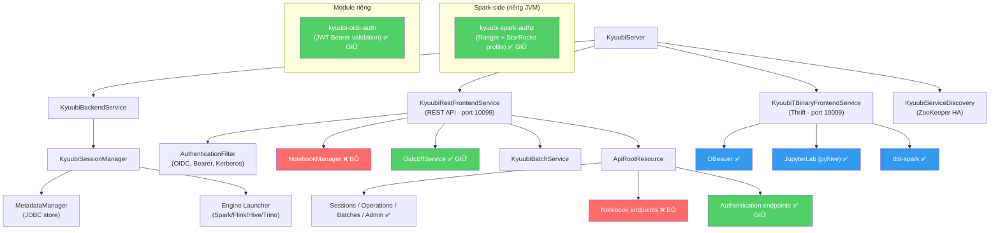
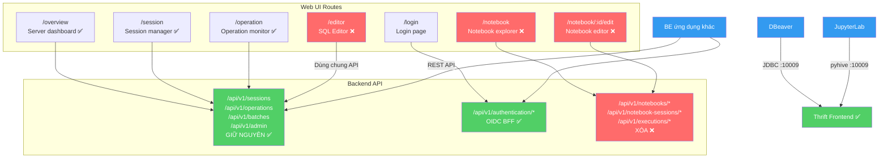
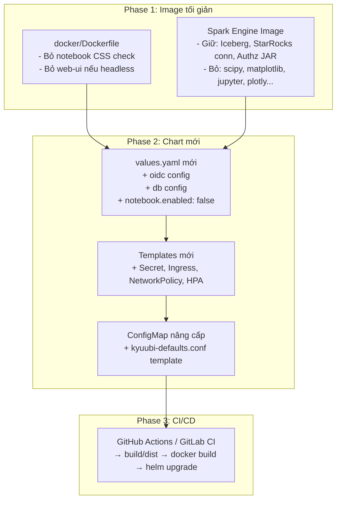

# Kế hoạch tối giản Kyuubi: Bỏ Notebook + SQL UI, giữ Authz + API Bridge

> **Ngày tạo:** 2024-09-24
> **Mục tiêu:** Loại bỏ notebook subsystem và SQL Editor UI khỏi Kyuubi fork, chỉ giữ lại OIDC authentication, Ranger authorization, và REST/Thrift API để ứng dụng BE khác (cũng như DBeaver, JupyterLab) kết nối vào.
> **Trạng thái:** Phân tích — chưa thực hiện code change.

---

## Mục lục

1. [Kiến trúc hiện tại](#1-kiến-trúc-hiện-tại)
2. [Các thành phần cần GIỮ](#2-các-thành-phần-cần-giữ)
3. [Các thành phần cần LOẠI BỎ](#3-các-thành-phần-cần-loại-bỏ)
4. [REST API Core vs Notebook — So sánh khả năng](#4-rest-api-core-vs-notebook--so-sánh-khả-năng)
5. [Kế hoạch loại bỏ SQL Editor + Notebook khỏi UI](#5-kế-hoạch-loại-bỏ-sql-editor--notebook-khỏi-ui)
6. [Tương thích với DBeaver và JupyterLab](#6-tương-thích-với-dbeaver-và-jupyterlab)
7. [Helm Chart & Docker — Xây lại](#7-helm-chart--docker--xây-lại)
8. [Phương án thực hiện — 2 cấp độ](#8-phương-án-thực-hiện--2-cấp-độ)
9. [Rủi ro và lưu ý](#9-rủi-ro-và-lưu-ý)
10. [Kết luận](#10-kết-luận)

---

## 1. Kiến trúc hiện tại

**Kết luận tổng thể: Hoàn toàn khả thi** — Notebook, OIDC, Ranger authz, và REST API core hoàn toàn độc lập với nhau.



---

## 2. Các thành phần cần GIỮ

### 2.1 OIDC Authentication (Bearer + BFF)

| Thành phần | Vị trí | Phụ thuộc Notebook? |
|---|---|---|
| `JwtTokenAuthenticationProvider` | `extensions/server/kyuubi-oidc-auth/` | ❌ Không |
| `DenyPasswordAuthenticationProvider` | cùng module | ❌ Không |
| `OidcBffService` + `OidcSessionStore` | `server/http/authentication/oidc/` | ❌ Không |
| `AuthenticationFilter` chain | `server/http/authentication/` | ❌ Không |
| OIDC REST endpoints | `ApiRootResource.scala` L62–L193 | ❌ Không |

**Kết luận:** OIDC hoàn toàn độc lập. Config dùng raw `conf.getOption()`, không đăng ký `KyuubiConf` entry.

### 2.2 Ranger Authz (+ StarRocks profile)

| Thành phần | Vị trí | Phụ thuộc gì? |
|---|---|---|
| `RangerServiceProfile` | `extensions/spark/kyuubi-spark-authz/` | Chỉ Spark (provided scope) |
| `StarRocksRangerServiceProfile` | cùng module | Ranger + Spark |
| `SparkRangerAdminPlugin` | cùng module | Ranger API |

**Kết luận:** Module này chạy **bên trong Spark JVM**, không chạy trong Kyuubi server. Hoàn toàn decoupled.

### 2.3 Core REST API (Bridge cho ứng dụng BE khác)

| Endpoint | Mô tả | Dùng cho |
|---|---|---|
| `POST /api/v1/sessions` | Mở session (Spark/Flink/Hive/Trino) | ✅ Chạy query từ app khác |
| `POST /api/v1/sessions/{id}/operations/statement` | Chạy SQL statement | ✅ API bridge |
| `GET /api/v1/operations/{id}` | Poll trạng thái | ✅ API bridge |
| `GET /api/v1/operations/{id}/rowset` | Lấy kết quả | ✅ API bridge |
| `GET /api/v1/operations/{id}/log` | Lấy log | ✅ API bridge |
| `POST /api/v1/batches` | Submit batch job | ✅ API bridge |
| `GET /api/v1/admin/*` | Quản trị | ✅ Admin |
| `GET /api/v1/authentication/*` | OIDC flow | ✅ Auth |

### 2.4 Thrift Binary Frontend (port 10009)

> **QUAN TRỌNG:** DBeaver, dbt, pyhive (JupyterLab) đều dùng **JDBC/Thrift** (port 10009), không dùng REST API. Phải giữ Thrift Binary frontend.

---

## 3. Các thành phần cần LOẠI BỎ

### 3.1 Notebook subsystem (FE + BE)

| # | Cần xóa/sửa | File | Mức độ |
|---|---|---|---|
| 1 | Toàn bộ notebook code | `server/notebook/**` | Xóa thư mục |
| 2 | `NotebookManager` lazy val + import | `KyuubiRestFrontendService.scala` L39–L41, L73–L78 | Xóa vài dòng |
| 3 | `NotebookRoutingFilter` setup | cùng file L134–L142 | Xóa vài dòng |
| 4 | `addService(notebookManager)` | cùng file L116 | Xóa 1 dòng |
| 5 | **11** notebook `@Path` locators | `ApiRootResource.scala` L206–L240 | Xóa ~35 dòng |
| 6 | Notebook REST resource classes | `NotebookFoldersResource`, `NotebooksResource`, `NotebookImportResource`, `NotebookSearchResource`, `CurrentUserResource`, `NotebookStatusResource`, `RuntimeSpecsResource`, `NotebookSessionsResource`, `NotebookRuntimesResource`, `ExecutionsResource`, `NotebookEngineProfilesResource` | Xóa 6+ files |
| 7 | `NotebookExceptionMapper` registration | `OpenAPIConfig` (Jersey provider) | Xóa 1 dòng |
| 8 | Notebook DDL scripts | `resources/sql/notebook/{mysql,postgresql,sqlite}/` | Xóa thư mục |
| 9 | Web UI notebook views | `web-ui/src/views/notebook/` + router entries | Xóa thư mục + sửa router |
| 10 | Notebook tests | `*NotebookTest*`, `*NotebookSuite*`, `NotebookSchemaUpgradeSuite` | Xóa files |
| 11 | Python env / packages | `docker/python-for-notebook/` | Xóa thư mục |

> **⚠️ Coupling point quan trọng:** `AuthenticationFilter.scala` import `NotebookConf` và `NotebookProxyIdentity` để xử lý peer notebook proxy headers (dùng cho cluster routing). Khi xóa notebook module, **phải xóa block này** khỏi `AuthenticationFilter`, nếu không sẽ compile error.

> Notebook đã có feature flag `kyuubi.notebook.enabled` (mặc định `true` trong code, nhưng tắt được bằng config). Cách nhanh nhất là set `kyuubi.notebook.enabled=false`, nhưng nếu muốn xóa code hẳn thì danh sách trên + coupling point ở `AuthenticationFilter` là đầy đủ.

### 3.2 SQL Editor (chỉ FE — không cần sửa BE)

| Thành phần | Vị trí | Sửa gì |
|---|---|---|
| SQL Editor view | `web-ui/src/views/editor/` | Xóa thư mục |
| Editor API module | `web-ui/src/api/editor/` | Xóa thư mục |
| Route `/editor` | `web-ui/src/router/index.ts` | Xóa route entry |
| Sidebar menu item | `web-ui/src/views/layout/components/sidebar/` | Xóa menu entry |

> **Phát hiện quan trọng:** SQL Editor trên Web UI **KHÔNG CÓ backend riêng**. Nó gọi đúng các endpoint core (`/sessions`, `/operations`) mà BE khác cũng gọi. Bỏ SQL Editor = **chỉ sửa FE, không động BE.**

### 3.3 Các engine/protocol có thể tắt (không cần xóa code)

| Tính năng | Config | Mặc định |
|---|---|---|
| Thrift HTTP frontend | `kyuubi.frontend.protocols` | Tắt |
| MySQL frontend | `kyuubi.frontend.protocols` | Tắt |
| Web UI | `kyuubi.frontend.rest.ui.enabled` | Bật |
| Batch service | `kyuubi.batch.submitter.enabled` | Tắt |

---

## 4. REST API Core vs Notebook — So sánh khả năng

### 4.1 Core REST API — Có sẵn gì?

```
POST   /api/v1/sessions                              ← Mở session (Spark/Flink/Trino/Hive/JDBC)
POST   /api/v1/sessions/{id}/operations/statement     ← Chạy SQL (sync hoặc async)
GET    /api/v1/operations/{id}                        ← Poll trạng thái
GET    /api/v1/operations/{id}/rowset?maxRows=1000    ← Lấy kết quả (phân trang cursor)
GET    /api/v1/operations/{id}/log                    ← Lấy log
PUT    /api/v1/operations/{id}  {action: "cancel"}    ← Hủy query
GET    /api/v1/operations/{id}/resultsetmetadata      ← Lấy schema cột

POST   /api/v1/batches                                ← Submit batch job (spark-submit style)
GET    /api/v1/batches/{id}                           ← Trạng thái batch
GET    /api/v1/batches/{id}/localLog                  ← Log batch

GET    /api/v1/sessions/{id}/operations/catalogs      ← List catalogs
POST   /api/v1/sessions/{id}/operations/schemas       ← List schemas
POST   /api/v1/sessions/{id}/operations/tables        ← List tables
POST   /api/v1/sessions/{id}/operations/columns       ← List columns
POST   /api/v1/sessions/{id}/operations/functions     ← List functions
```

Khi mở session, truyền config map để chọn engine:
```json
{
  "configs": {
    "kyuubi.engine.type": "SPARK_SQL",
    "kyuubi.engine.share.level": "USER",
    "kyuubi.operation.language": "PYTHON",
    "spark.driver.memory": "2g"
  }
}
```

### 4.2 Notebook bổ sung gì mà Core REST API không có?

| Tính năng | Core REST API | Notebook thêm | Quan trọng? |
|---|---|---|---|
| **Chạy SQL** | ✅ Đầy đủ | Wrapper mỏng, y hệt | — |
| **Chạy PySpark** | ⚠️ Có thể — phải tự set `kyuubi.operation.language=PYTHON` + `output.mode=NOTEBOOK` | ✅ Auto-configure | Trung bình |
| **Kết quả dạng bảng** | ⚠️ Raw `TRowSet` (Thrift binary) hoặc Arrow IPC bytes | ✅ Server decode → JSON rows | **Cao** |
| **Rich output (biểu đồ, HTML)** | ❌ Không decode, client nhận raw bytes | ✅ Decode + sanitize HTML/SVG/PNG | Cao nếu cần visualization |
| **Arrow IPC decode** | ❌ Client phải tự decode | ✅ Server-side decode | **Cao** |
| **Lịch sử execution** | ❌ Ephemeral (operation mất khi close) | ✅ Lưu DB, query lại được | Trung bình |
| **Event streaming (long-poll)** | ❌ Chỉ polling `GET /operations/{id}` | ✅ Long-poll events | Trung bình |
| **Idle session auto-reap** | ❌ Phải tự close | ✅ Background reaper | Thấp |
| **Multi-runtime/session** | ❌ 1 engine/session | ✅ SQL + PySpark cùng session | Trung bình |
| **Document persistence** | ❌ Không có | ✅ Folders, notebooks, cells, revisions | Cao cho notebook UX |
| **Permission model** | ❌ Admin-level | ✅ OWNER/WRITE/READ per notebook | Cao cho multi-tenant |
| **Scheduling (cron)** | ❌ Không có | ✅ Cron-based notebook run | Trung bình |
| **Import/Export (.ipynb)** | ❌ Không có | ✅ Jupyter format | Thấp |

### 4.3 Gap Analysis theo từng kịch bản

```
                              REST API Core đủ không?

 Use case                  │  Đủ?  │  Thiếu gì?
───────────────────────────┼────────┼──────────────────────────
 SQL Platform / BI backend │  ✅    │  Converter TRowSet→JSON
 dbt                       │  ✅*   │  Không thiếu (*dùng Thrift)
 DBeaver                   │  ✅*   │  Không thiếu (*dùng JDBC)
 JupyterLab (pyhive/SQL)   │  ✅*   │  Không thiếu (*dùng Thrift)
 PySpark interactive code  │  ⚠️    │  Rich output decode + sanitize
 Notebook-like UI          │  ❌    │  Document model, permissions,
                           │        │  execution history, scheduling
```

### 4.4 Khuyến nghị

- **Nếu mục tiêu là "BE khác gọi SQL / submit batch"** → REST API core dư sức. Chỉ cần thêm 1 middleware layer mỏng ở phía BE để parse `TRowSet`.
- **Nếu mục tiêu là "thay thế hoàn toàn notebook bằng BE riêng"** → REST API core là foundation đủ, nhưng BE phải tự build result converter, PySpark rich output decoder, domain model.
- **DBeaver / dbt / JupyterLab (pyhive)** → Dùng JDBC/Thrift, không liên quan REST API hay notebook.

---

## 5. Kế hoạch loại bỏ SQL Editor + Notebook khỏi UI

### Bản đồ Web UI hiện tại



### Quan hệ FE ↔ BE — Minh họa

```
 XÓA (FE only)              GIỮ NGUYÊN (BE)              XÓA (FE + BE)
┌──────────────┐     ┌──────────────────────────┐    ┌──────────────────┐
│ SQL Editor   │────▶│ /api/v1/sessions         │◀───│                  │
│ (Vue views)  │     │ /api/v1/operations       │    │ Notebook BE      │
│              │     │ /api/v1/batches          │    │ /api/v1/notebooks│
│ Notebook UI  │────▶│ /api/v1/admin            │    │ /api/v1/notebook-│
│ (Vue views)  │     │ /api/v1/authentication   │    │  sessions, etc.  │
└──────────────┘     └──────────▲───────────────┘    └──────────────────┘
                                │
                     ┌──────────┴───────────┐
                     │  BE ứng dụng khác    │
                     │  DBeaver (JDBC)      │
                     │  JupyterLab (pyhive) │
                     │  dbt (Thrift)        │
                     │  (vẫn gọi được 100%) │
                     └──────────────────────┘
```

Sau khi xóa, Web UI chỉ còn 3 trang: **Overview**, **Session**, **Operation** — đủ cho admin monitoring. Tất cả tools bên ngoài vẫn hoạt động bình thường.

---

## 6. Tương thích với DBeaver và JupyterLab

### DBeaver → JDBC/Thrift (port 10009) ✅

DBeaver kết nối qua **JDBC driver**, hoàn toàn không đụng Web UI hay notebook:

```
JDBC URL: jdbc:hive2://kyuubi-server:10009/default
Driver:   kyuubi-hive-jdbc (hoặc Hive JDBC chuẩn)
```

Đường đi: `DBeaver → Thrift Binary → KyuubiTBinaryFrontendService → Engine (Spark/Trino/...)` — không đi qua REST API hay notebook code.

### JupyterLab → Thrift hoặc REST API ✅

JupyterLab trên máy local có nhiều cách kết nối:

**Cách 1 — PySpark trực tiếp (phổ biến nhất):**
```python
from pyspark.sql import SparkSession

spark = SparkSession.builder \
    .master("local") \
    .config("hive.metastore.uris", "thrift://metastore:9083") \
    .enableHiveSupport() \
    .getOrCreate()
```

**Cách 2 — pyhive/JDBC (nhẹ hơn, chỉ gửi SQL):**
```python
from pyhive import hive

conn = hive.connect(host='kyuubi-server', port=10009, database='default')
cursor = conn.cursor()
cursor.execute("SELECT * FROM my_table LIMIT 10")
print(cursor.fetchall())
```

**Cách 3 — REST API (nếu muốn):**
```python
import requests

# Mở session
s = requests.post("http://kyuubi:10099/api/v1/sessions",
    json={"configs": {"kyuubi.engine.type": "SPARK_SQL"}},
    headers={"Authorization": "Bearer <token>"})

# Chạy SQL
op = requests.post(f"http://kyuubi:10099/api/v1/sessions/{handle}/operations/statement",
    json={"statement": "SELECT * FROM table", "runAsync": True})
```

### Bảng tổng hợp tương thích

| Tool | Kết nối qua | Phụ thuộc notebook/SQL Editor? | Sau khi bỏ? |
|---|---|---|---|
| **DBeaver** | JDBC Thrift `:10009` | ❌ Không | ✅ Chạy bình thường |
| **JupyterLab** (pyhive) | Thrift `:10009` | ❌ Không | ✅ Chạy bình thường |
| **JupyterLab** (PySpark) | Trực tiếp Spark hoặc Thrift | ❌ Không | ✅ Chạy bình thường |
| **JupyterLab** (REST) | HTTP `:10099` | ❌ Không | ✅ Chạy bình thường |
| **dbt** | Thrift JDBC `:10009` | ❌ Không | ✅ Chạy bình thường |
| **Superset / Metabase** | JDBC Thrift `:10009` | ❌ Không | ✅ Chạy bình thường |
| **Custom BE app** | REST API `:10099` | ❌ Không | ✅ Chạy bình thường |

> **Notebook subsystem của Kyuubi** là notebook **server-side** (chạy PySpark bên trong Kyuubi engine). **JupyterLab của bạn** là notebook **client-side** (chạy trên máy local, gọi vào Kyuubi như một client). Hai thứ hoàn toàn độc lập — bỏ cái server-side không ảnh hưởng gì đến cái client-side.

---

## 7. Helm Chart & Docker — Xây lại

### 7.1 Chart hiện tại

Chart upstream tại `charts/kyuubi/` (Helm v3, chart v0.1.0, appVersion 1.10.0):

```
charts/kyuubi/
├── Chart.yaml
├── values.yaml                       (310 dòng)
└── templates/
    ├── kyuubi-statefulset.yaml        ← Deploy chính (StatefulSet, 2 replicas)
    ├── kyuubi-service.yaml            ← Expose Thrift (10009), REST (10099)
    ├── kyuubi-headless-service.yaml   ← Headless cho StatefulSet identity
    ├── kyuubi-configmap.yaml          ← kyuubi-env.sh, kyuubi-defaults.conf, log4j2.xml
    ├── kyuubi-spark-configmap.yaml    ← spark-env.sh, spark-defaults.conf
    ├── kyuubi-serviceaccount.yaml     ← SA với quyền create/list/delete pods
    ├── kyuubi-role.yaml / kyuubi-rolebinding.yaml
    ├── kyuubi-podmonitor.yaml / kyuubi-servicemonitor.yaml
    ├── kyuubi-priorityclass.yaml
    └── kyuubi-alert.yaml
```

### 7.2 Docker images

| Image | Dockerfile | Giữ/Bỏ |
|---|---|---|
| **Kyuubi Server** | `docker/Dockerfile` | ✅ Giữ, sửa bỏ notebook CSS check |
| **PySpark Notebook Engine** | `docker/python-for-notebook/Dockerfile.spark-py311` | ⚠️ Đổi thành Spark engine image (bỏ notebook Python packages, giữ authz + connectors) |
| **Spark Image Builder** | `bin/build-spark-image.sh` | ✅ Giữ |
| **Playground** | `docker/playground/compose.yml` | ⚠️ Tùy chọn giữ cho dev |

### 7.3 Những gì thiếu cho deployment mới

| Cần thêm | Lý do | Ưu tiên |
|---|---|---|
| OIDC config section trong `values.yaml` | Hiện chưa có | **Cao** |
| `Secret` template cho OIDC | Client secret, DB password | **Cao** |
| External Database config | Metadata store (PostgreSQL/MySQL) | **Cao** |
| Ingress template với TLS | Expose REST API ra ngoài cluster | **Cao** |
| Health check dùng REST endpoint | Chuyển sang `GET /api/v1/ping` | Trung bình |
| HPA (Horizontal Pod Autoscaler) | Autoscaling | Trung bình |
| `NetworkPolicy` | Restrict traffic | Trung bình |
| `PodDisruptionBudget` | Availability | Trung bình |
| Notebook-related cleanup | Bỏ notebook CSS check, Python packages | **Cao** |

### 7.4 Chiến lược xây dựng lại



---

## 8. Phương án thực hiện — 2 cấp độ

### Cấp 1: Tắt bằng config (nhanh, không sửa code)

```properties
# kyuubi-defaults.conf
kyuubi.notebook.enabled=false
kyuubi.frontend.protocols=REST,THRIFT_BINARY
kyuubi.frontend.rest.ui.enabled=false
kyuubi.batch.submitter.enabled=false

# OIDC
kyuubi.authentication.method=BEARER
kyuubi.authentication.custom.bearer.class=org.apache.kyuubi.oidc.JwtTokenAuthenticationProvider
kyuubi.authentication.jwt.issuer=https://keycloak.example.com/realms/myrealm
kyuubi.authentication.jwt.jwks.url=https://keycloak.example.com/realms/myrealm/protocol/openid-connect/certs
```

> **Ưu điểm:** Zero code change. Deploy ngay.
> **Nhược điểm:** Docker image vẫn chứa code/dependency không dùng.

### Cấp 2: Xóa code + rebuild image + chart mới (clean)

#### Phase 1: FE — Bỏ SQL Editor + Notebook UI

```
Chỉ sửa ở kyuubi-server/web-ui/:

□ Xóa src/views/editor/           (SQL Editor)
□ Xóa src/views/notebook/         (Notebook)
□ Xóa src/api/editor/             (Editor API calls)
□ Xóa src/api/notebook/           (Notebook API calls)
□ Sửa src/router/index.ts         (xóa routes: /editor, /notebook*)
□ Sửa layout sidebar              (xóa menu: SQL Editor, Notebook)
□ Chạy pnpm build để verify
```

#### Phase 2: BE — Bỏ Notebook backend

```
Sửa ở kyuubi-server Scala code:

□ Xóa server/notebook/**          (toàn bộ notebook package)
□ Sửa KyuubiRestFrontendService   (xóa NotebookManager refs)
□ Sửa ApiRootResource             (xóa 11 notebook @Path locators)
□ Sửa AuthenticationFilter        (xóa NotebookProxyIdentity import)
□ Xóa resources/sql/notebook/     (DDL scripts)
□ Xóa notebook test suites
□ Chạy build/mvn compile để verify
```

#### Phase 3: Docker/Helm

```
□ Sửa docker/Dockerfile           (bỏ notebook CSS check)
□ Sửa Spark engine image          (bỏ Python notebook packages)
□ Cập nhật Helm chart values.yaml  (OIDC config, DB config)
□ Thêm templates: Secret, Ingress, NetworkPolicy
```

---

## 9. Rủi ro và lưu ý

| Rủi ro | Mức | Giải pháp |
|---|---|---|
| Notebook code compile-coupled | Thấp | `NOTEBOOK_ENABLED` flag guard tất cả runtime path |
| OIDC BFF thay đổi có thể break | Cao | Đọc `plans/fix_oidc.md` trước khi sửa |
| Ranger authz cần Spark image riêng | Trung bình | Mount JAR qua init container hoặc custom Spark image |
| Upstream merge conflict khi xóa code | Trung bình | Giữ branch riêng, rebase cẩn thận |
| Helm chart không có test | Thấp | Dùng `helm template` + `kubeval` để validate |

---

## 10. Kết luận

| Câu hỏi | Trả lời |
|---|---|
| Loại bỏ notebook + SQL Editor được không? | ✅ Có — notebook: config hoặc xóa code. SQL Editor: chỉ xóa FE. |
| Giữ authz + API bridge? | ✅ Có — OIDC + Ranger + REST/Thrift API hoàn toàn độc lập |
| BE khác gọi vào được? | ✅ Có — REST API `/sessions`, `/operations`, `/batches` giữ nguyên |
| DBeaver vẫn dùng được? | ✅ Có — JDBC/Thrift port 10009, không liên quan |
| JupyterLab vẫn dùng được? | ✅ Có — pyhive/PySpark qua Thrift hoặc REST API |
| dbt vẫn dùng được? | ✅ Có — dbt-spark/dbt-trino qua Thrift JDBC |
| Xây chart K8s mới? | ✅ Có — chart hiện tại là base tốt, cần bổ sung OIDC/DB/Ingress |
| Cần sửa bao nhiêu code? | Ít — Notebook touchpoint chỉ ở ~3 file core + xóa thư mục. SQL Editor: chỉ FE. |
